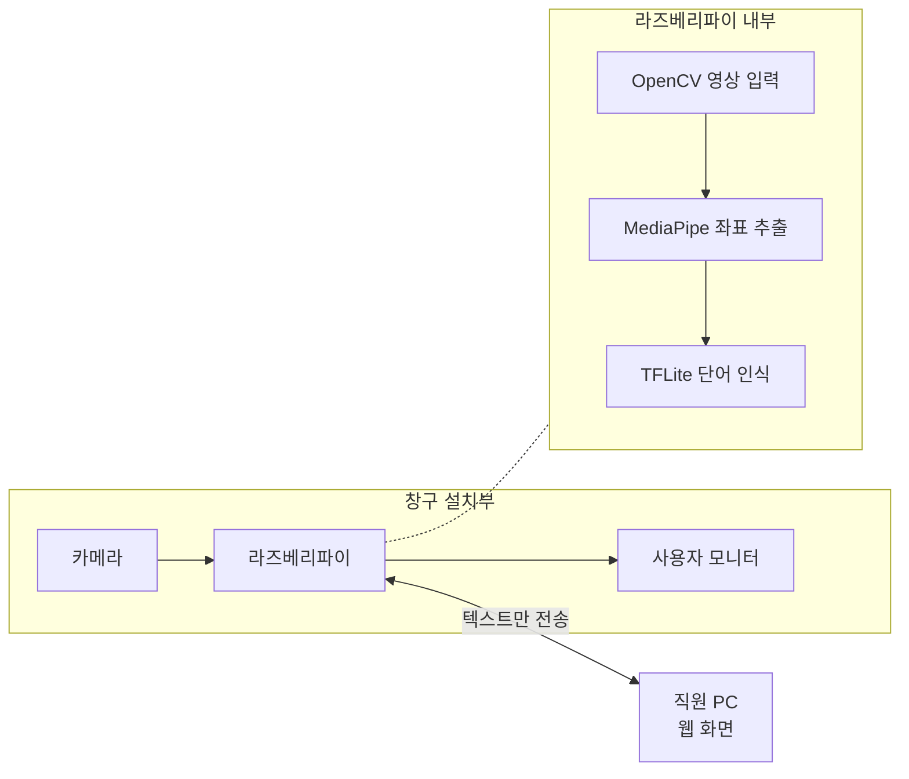
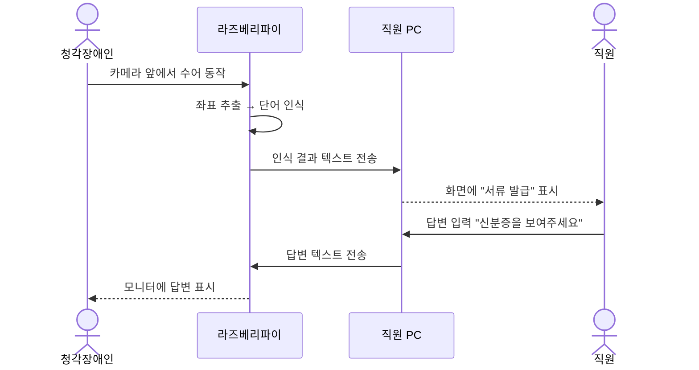
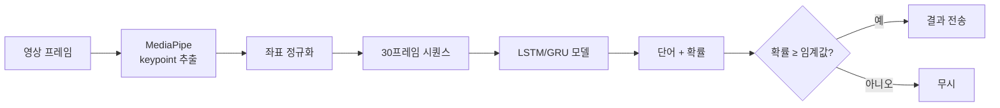
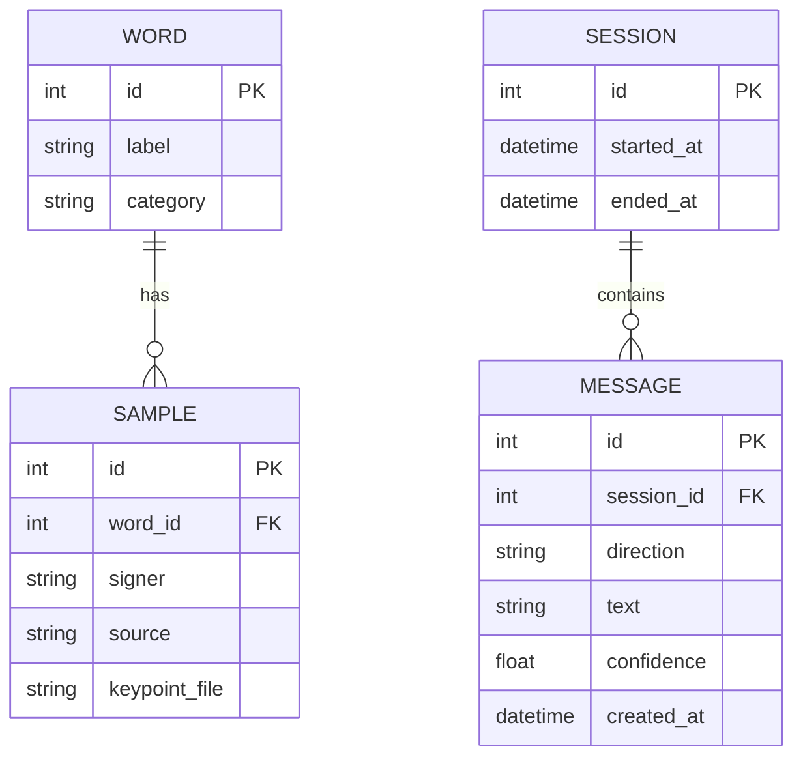
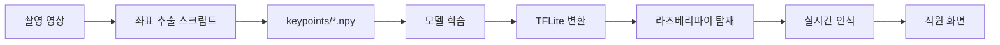
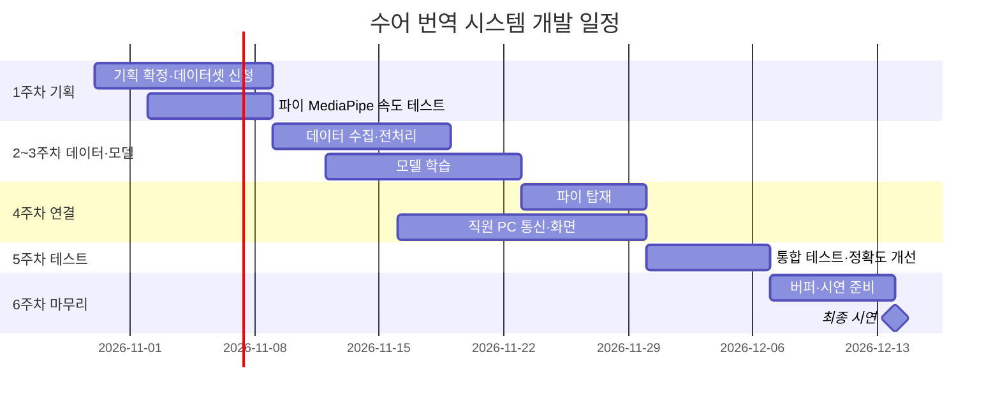

# 공공기관용 수어 번역 시스템 개발계획서

| 항목 | 내용 |
|------|------|
| 프로젝트명 | 공공기관용 수어 번역 시스템 (가칭) |
| 팀 | 4명 (팀원 A, B, C, D) |
| 작성일 | 2026-10-30 |
| 개발 기간 | 2026-10-30 ~ 2026-12-14 (약 6주) |
| 문서 버전 | v0.1 |
| 저장소 | https://github.com/203536/SL_Translation_System |

### 변경 이력

| 버전 | 날짜 | 작성자 | 변경 내용 |
|------|------|--------|-----------|
| v0.1 | 2026-10-30 | | 초안 작성 |

---

## 목차

1. [프로젝트 개요](#1-프로젝트-개요-overview)
2. [팀 구성 및 역할 분담](#2-팀-구성-및-역할-분담-team--roles)
3. [요구사항 정의](#3-요구사항-정의-requirements)
4. [범위 및 핵심 기능](#4-범위-및-핵심-기능-scope--core-features)
5. [시스템 및 기술 설계](#5-시스템-및-기술-설계-system--architecture-design)
6. [하드웨어 구성 및 예산](#6-하드웨어-구성-및-예산-hardware--budget)
7. [AI 모델 설계 및 데이터 수집](#7-ai-모델-설계-및-데이터-수집-ai-model--dataset)
8. [데이터 설계](#8-데이터-설계-data-design)
9. [테스트 및 품질 관리](#9-테스트-및-품질-관리-testing--qa)
10. [리스크 관리](#10-리스크-관리-risk-management)
11. [개인정보 및 윤리](#11-개인정보-및-윤리-privacy--ethics)
12. [일정 관리](#12-일정-관리-schedule--milestones)

---

## 1. 프로젝트 개요 (Overview)

### 1.1 배경
- AI로 대부분의 언어가 실시간 번역되지만, 수어 번역은 아직 대중화되지 않았다.
- 청각장애인은 공공기관(주민센터, 민원실 등)에서 여전히 의사소통에 어려움을 겪는다.
- 기존 대안의 한계
  - **필담**: 많은 농인에게 수어가 제1언어이므로 한국어 필담만으로는 불편하다.
  - **영상통화 수어통역(손말이음센터 등)**: 통역사 연결 대기가 필요하고, 현장 창구에서 바로 쓰기 어렵다.
  - **문자 키오스크**: 정해진 메뉴 외의 소통이 어렵다.

### 1.2 목적
- 공공기관 창구에 설치해, 청각장애인의 수어를 AI가 인식하여 직원 PC에 텍스트로 보여준다.
- 직원의 답변을 텍스트로 모니터에 띄워 **양방향 소통**을 지원한다.
- 12월 14일까지 동작하는 프로토타입을 완성하고 시연한다.

### 1.3 기대효과
| 구분 | 기대효과 |
|------|----------|
| 사용자 측면 | 청각장애인이 통역사 없이 창구에서 기본 민원 소통 가능 |
| 기관 측면 | 직원이 수어를 몰라도 응대 가능, 응대 시간 단축 |
| 기술적 측면 | 엣지 디바이스(라즈베리파이)에서 동작하는 경량 수어 인식 모델 구현 |
| 학습 측면 | 영상처리(OpenCV), 임베디드, 딥러닝, 네트워크 통신 통합 경험 |

### 1.4 용어 정의
| 용어 | 설명 |
|------|------|
| 수어(수화) | 손 모양, 움직임, 표정 등으로 의미를 전달하는 시각 언어. 한국수어는 한국어와 문법이 다름 |
| 농인 | 청각장애가 있으며 수어를 주 언어로 사용하는 사람 |
| 비수지 신호 | 표정, 입 모양, 고개 움직임 등 손 이외의 수어 요소 |
| Keypoint (랜드마크) | MediaPipe가 추출하는 손·몸의 관절 좌표 |
| MediaPipe | Google의 실시간 손·포즈 추적 라이브러리 |
| LSTM / GRU | 시간 순서가 있는 데이터(좌표 시퀀스)를 학습하는 신경망 구조 |
| TFLite | 라즈베리파이 같은 저사양 기기용 경량 TensorFlow 모델 형식 |
| MVP | 최소 기능 제품. 첫 시연에 반드시 동작해야 하는 범위 |

---

## 2. 팀 구성 및 역할 분담 (Team & Roles)

| 역할 | 담당자 | 주요 업무 |
|------|--------|-----------|
| 데이터 수집·전처리 | 팀원 A | 공개 데이터셋 확보, 직접 촬영, 좌표 추출·라벨링 |
| AI 모델 학습 | 팀원 B | 모델 설계·학습, 정확도 평가, TFLite 변환 |
| 라즈베리파이·카메라 | 팀원 C | 하드웨어 구성, 파이 탑재, 속도 최적화 |
| 직원용 화면·통신 | 팀원 D | 파이↔직원 PC 통신, 직원 화면, 모니터 텍스트 출력 |
| PM (겸임) | | 일정 관리, 회의 진행, 문서 관리 |

### 협업 규칙
| 항목 | 규칙 |
|------|------|
| 코드·문서 | GitHub 저장소 (이 문서 포함) |
| 작업 관리 | GitHub Issues + Projects(칸반 보드) |
| 소통 | Discord (GitHub 알림 채널 연동) |
| 대용량 데이터 | Google Drive 공유 폴더 (영상·데이터셋은 Git에 올리지 않음) |
| 정기 회의 | 주 1~2회, 진행 상황·막힌 점 공유 |
| 브랜치 전략 | `main`(시연용) / `develop`(통합) / `feature/기능명` |
| 커밋 메시지 | `feat:` `fix:` `docs:` `refactor:` `data:` `model:` |
| 코드 리뷰 | `develop` 머지 전 팀원 1명 이상 승인 |

---

## 3. 요구사항 정의 (Requirements)

### 3.1 기능적 요구사항
> 우선순위: **상**(MVP 필수) / **중**(권장) / **하**(여유 시)

| ID | 기능명 | 설명 | 우선순위 |
|----|--------|------|----------|
| FR-01 | 영상 입력 | 카메라로 사용자의 수어 동작을 실시간 촬영 | 상 |
| FR-02 | 좌표 추출 | MediaPipe로 손·포즈 keypoint 추출 | 상 |
| FR-03 | 단어 인식 | 좌표 시퀀스를 AI 모델로 분석해 수어 단어 인식 | 상 |
| FR-04 | 직원 화면 출력 | 인식 결과를 직원 PC에 텍스트로 실시간 표시 | 상 |
| FR-05 | 답변 출력 | 직원이 입력한 텍스트를 사용자 모니터에 표시 | 상 |
| FR-06 | 인식 상태 표시 | 손 인식 여부, "인식 중" 상태를 모니터에 표시 | 중 |
| FR-07 | 문장 조합 | 인식된 단어들을 순서대로 이어 간단한 문장처럼 표시 | 중 |
| FR-08 | 대화 기록 | 대화 텍스트 로그 저장 (영상은 저장 안 함) | 하 |
| FR-09 | 음성 인식 답변 | 직원 음성을 텍스트로 변환해 모니터에 표시 | 하 |

### 3.2 비기능적 요구사항
| ID | 분류 | 요구사항 | 측정 기준 |
|----|------|----------|-----------|
| NFR-01 | 정확도 | 대상 단어 인식 정확도 | 테스트셋 기준 80% 이상 (목표) |
| NFR-02 | 성능 | 동작 종료 후 결과 표시까지 지연 | 2초 이내 |
| NFR-03 | 성능 | 파이에서 좌표 추출 속도 | 15 FPS 이상 (1주차 측정 후 조정) |
| NFR-04 | 보안·개인정보 | 영상 미저장, 텍스트만 전송 | 저장소·네트워크에 영상 없음 |
| NFR-05 | 사용성 | 별도 조작 없이 카메라 앞에서 수어만 하면 동작 | 사용자 조작 0회 |
| NFR-06 | 안정성 | 연속 동작 | 30분 이상 오류 없이 동작 |
| NFR-07 | 유지보수성 | 설치·실행 방법 문서화 | README만 보고 실행 가능 |

---

## 4. 범위 및 핵심 기능 (Scope & Core Features)

### 4.1 MVP 범위
| 기능 | 관련 요구사항 |
|------|----------------|
| 공공기관 민원 상황 단어 20~50개 인식 | FR-01 ~ FR-03 |
| 직원 PC에 인식 결과 텍스트 표시 | FR-04 |
| 직원 입력 텍스트를 사용자 모니터에 표시 | FR-05 |

**인식 대상 단어 후보 (팀 회의로 확정)**

| 분류 | 단어 예시 |
|------|-----------|
| 인사·기본 | 안녕하세요, 감사합니다, 네, 아니요, 다시, 모르겠어요 |
| 요청 | 도와주세요, 기다려주세요, 천천히 |
| 민원 | 서류, 발급, 신청, 등본, 신분증, 도장, 돈(수수료) |
| 장소·안내 | 화장실, 어디, 몇 번, 창구 |

### 4.2 향후 확장 (Post-MVP)
- 단어 조합을 통한 간단한 문장 표시 (FR-07)
- 직원 음성 → 텍스트 변환 (FR-09)
- 인식 단어 수 확대, 표정(비수지 신호) 반영

### 4.3 제외 범위 (Out of Scope)
- 문법을 고려한 완전한 문장 단위 수어 번역
- 한국어 → 수어 영상(아바타) 생성
- 실제 공공기관 정식 설치·운영
- 대화 영상 저장 및 분석

---

## 5. 시스템 및 기술 설계 (System & Architecture Design)

### 5.1 기술 스택
| 구분 | 기술 | 선정 이유 |
|------|------|-----------|
| 언어 | Python 3 | 영상처리·AI·라즈베리파이 모두 지원 |
| 영상 처리 | OpenCV | 카메라 입력, 전처리, 화면 표시 |
| 좌표 추출 | MediaPipe (Hands / Holistic) | 영상 대신 좌표로 학습해 데이터·연산 부담 감소 |
| 모델 학습 | TensorFlow / Keras (Colab 또는 PC) | LSTM/GRU 구현 용이, TFLite 변환 지원 |
| 추론 | TFLite | 라즈베리파이에서 경량 추론 |
| 통신 | Python socket 또는 WebSocket (Flask-SocketIO / FastAPI) | 텍스트만 실시간 전송 |
| 직원 화면 | 웹 페이지 (Flask) | 직원 PC에 별도 설치 없이 브라우저로 접속 |
| 협업 | GitHub, Discord, Google Drive | 2장 협업 규칙 참고 |

### 5.2 아키텍처 구조도



- **기본안**: 라즈베리파이가 촬영 → 좌표 추출 → 추론까지 처리하고 결과 텍스트만 전송한다.
- **대안 (1주차 속도 측정 결과가 부족할 경우)**: 파이는 촬영·좌표 추출만, 추론은 직원 PC(또는 서버)에서 처리한다.

### 5.3 컴포넌트 간 상호작용

| 컴포넌트 | 역할 | 연동 대상 |
|----------|------|-----------|
| 카메라 | 수어 동작 촬영 | 라즈베리파이 |
| 인식 모듈 (파이) | 좌표 추출, 단어 인식 | 통신 모듈 |
| 통신 모듈 | 인식 결과 송신, 직원 답변 수신 | 직원 PC |
| 사용자 모니터 | 인식 상태, 직원 답변 표시 | 라즈베리파이 |
| 직원 화면 (웹) | 인식 결과 표시, 답변 입력 | 통신 모듈 |

**주요 시나리오 시퀀스**



---

## 6. 하드웨어 구성 및 예산 (Hardware & Budget)

| 품목 | 사양 | 수량 | 보유 여부 | 예상 비용 |
|------|------|------|-----------|-----------|
| 라즈베리파이 | 모델 확인 필요 (4 / 5) | 1 | | |
| 카메라 | Pi Camera 모듈 또는 USB 웹캠 | 1 | | |
| 사용자 모니터 | HDMI 모니터 | 1 | | |
| 직원용 PC | 노트북 등 (웹 브라우저) | 1 | | |
| 전원·SD카드·케이블 | | 1식 | | |
| 쿨러/케이스 | 연속 추론 시 발열 대비 | 1 | | |
| **합계** | | | | |

**설치 조건 (인식 환경 고정)**
- 카메라 앞 약 1m 위치에 서는 자리 표시
- 단색 배경, 정면 조명
- 상반신(손·어깨·얼굴)이 화면에 모두 들어오는 카메라 높이

---

## 7. AI 모델 설계 및 데이터 수집 (AI Model & Dataset)

### 7.1 처리 파이프라인



### 7.2 데이터 수집 계획
| 출처 | 내용 | 담당 | 비고 |
|------|------|------|------|
| 공개 데이터셋 | AI Hub 한국수어 영상 데이터 | 팀원 A | 신청·승인 기간 확인 필요, 대상 단어만 추출 |
| 직접 촬영 | 팀원 4명이 대상 단어 촬영 | 전원 | 단어당 1인 20회 이상 목표 |
| 증강 | 좌우 반전, 속도 변화, 좌표 노이즈 | 팀원 A | 데이터 부족 시 |

**촬영 규칙**
- 6장의 설치 조건과 같은 환경에서 촬영
- 파일명 규칙: `단어_촬영자_번호.mp4` (예: `발급_A_001.mp4`)
- 원본 영상은 Google Drive에만 보관, Git에는 추출한 좌표 데이터 일부와 스크립트만 업로드

### 7.3 모델 설계
| 항목 | 내용 |
|------|------|
| 입력 | 30프레임 × keypoint 좌표 (손 21점 × 2 + 포즈 일부) |
| 구조 | LSTM 또는 GRU 2~3층 + Dense + Softmax |
| 출력 | 대상 단어별 확률 |
| 학습 환경 | Google Colab 또는 팀원 PC (GPU) |
| 배포 형식 | TFLite로 변환해 라즈베리파이에 탑재 |
| 데이터 분할 | 학습 70% / 검증 15% / 테스트 15% (촬영자 기준 분리 검토) |

### 7.4 평가 지표
| 지표 | 목표 |
|------|------|
| 테스트셋 정확도 | 80% 이상 |
| 단어별 정확도 (혼동 행렬) | 정확도 낮은 단어 파악 후 개선 |
| 파이 추론 지연 | 동작 종료 후 2초 이내 |
| 학습에 없던 사람의 인식률 | 시연 전 별도 측정 |

---

## 8. 데이터 설계 (Data Design)

### 8.1 데이터 구조



- `WORD`, `SAMPLE`: 학습 데이터 관리용 (CSV 또는 파일 구조로 관리 가능)
- `SESSION`, `MESSAGE`: 대화 텍스트 로그용 (FR-08, SQLite), 영상은 저장하지 않음

### 8.2 데이터 저장 구조

```
data/
├── raw/            # 원본 영상 (Git 제외, Google Drive 보관)
├── keypoints/      # 단어별 좌표 시퀀스 (.npy)
│   ├── 발급/
│   └── 서류/
└── labels.csv      # 단어 목록, 라벨 번호
models/
└── sign_model.tflite
```

### 8.3 데이터 흐름도



### 8.4 통신 메시지 명세

파이와 직원 PC는 JSON 메시지로 통신한다.

| 방향 | type | 내용 |
|------|------|------|
| 파이 → 직원 PC | `recognized` | 인식된 단어와 확률 |
| 파이 → 직원 PC | `status` | 손 인식 여부 등 상태 |
| 직원 PC → 파이 | `reply` | 직원이 입력한 답변 텍스트 |

```json
{ "type": "recognized", "text": "발급", "confidence": 0.92, "timestamp": "2026-12-01T10:00:00" }
```

```json
{ "type": "reply", "text": "신분증을 보여주세요", "timestamp": "2026-12-01T10:00:05" }
```

---

## 9. 테스트 및 품질 관리 (Testing & QA)

### 9.1 테스트 전략
| 종류 | 대상 | 방법 |
|------|------|------|
| 모델 테스트 | 인식 정확도 | 테스트셋 정확도, 혼동 행렬 |
| 성능 테스트 | 파이 FPS, 지연 시간 | 실제 파이에서 측정 |
| 통합 테스트 | 촬영 → 인식 → 전송 → 답변 | 전체 시나리오 수동 테스트 |
| 사용자 테스트 | 학습에 없던 사람 | 팀 외부 인원 시연 |

### 9.2 테스트 시나리오
| TC ID | 관련 요구사항 | 시나리오 | 기대 결과 | 결과 |
|-------|----------------|----------|-----------|------|
| TC-01 | FR-01, 02 | 카메라 앞에서 손을 듦 | 모니터에 손 인식 상태 표시 | ⬜ |
| TC-02 | FR-03, 04 | "발급" 수어 동작 | 직원 화면에 "발급" 표시 | ⬜ |
| TC-03 | FR-03 | 대상 외 동작 | 결과 표시 안 함 | ⬜ |
| TC-04 | FR-05 | 직원이 답변 입력 | 사용자 모니터에 답변 표시 | ⬜ |
| TC-05 | NFR-02 | 동작 종료 후 시간 측정 | 2초 이내 표시 | ⬜ |
| TC-06 | NFR-06 | 30분 연속 동작 | 오류·중단 없음 | ⬜ |
| TC-07 | NFR-01 | 처음 보는 사람이 수어 | 대상 단어 대부분 인식 | ⬜ |

> 결과: ✅ Pass / ❌ Fail / ⬜ 미실시

---

## 10. 리스크 관리 (Risk Management)

| ID | 리스크 요인 | 가능성 | 영향도 | 대응 전략 |
|----|-------------|--------|--------|-----------|
| R-01 | 파이에서 인식 속도 부족 | 중 | 상 | 1주차 측정, 부족 시 추론을 직원 PC로 이전 |
| R-02 | 학습 데이터 부족 | 중 | 상 | 직접 촬영 확대, 데이터 증강, 단어 수 축소 |
| R-03 | 공개 데이터셋 승인 지연 | 중 | 중 | 1주차에 즉시 신청, 직접 촬영 병행 |
| R-04 | 처음 보는 사람 인식률 저하 | 상 | 중 | 촬영자 다양화, 좌표 정규화, 설치 조건 고정 |
| R-05 | 조명·배경에 따른 정확도 변화 | 중 | 중 | 설치 조건 고정 (6장) |
| R-06 | 일정 지연·팀원 일정 변수 | 상 | 상 | 관문 방식 일정, 6주차 버퍼, 주간 회의 점검 |
| R-07 | 수어 동작의 정확성 (팀원이 비전문가) | 중 | 중 | 공식 수어 사전 영상 기준으로 촬영 |

---

## 11. 개인정보 및 윤리 (Privacy & Ethics)

- **영상 미저장**: 실시간 인식에만 사용하고 저장·전송하지 않는다. 네트워크로는 텍스트만 전송한다.
- **촬영 동의**: 학습용 촬영은 참여자 동의를 받고, 원본 영상은 팀 내부 Drive에만 보관한다.
- **안내 문구**: 실제 설치를 가정해 "카메라가 수어 인식에만 사용되며 영상은 저장되지 않습니다" 안내를 화면에 표시한다.
- **오인식 고지**: 인식 결과는 참고용이며, 오류 시 "다시" 요청이나 필담으로 확인하도록 안내한다.

---

## 12. 일정 관리 (Schedule & Milestones)

정확한 날짜보다 **"앞 단계가 끝나야 다음 단계로"** 넘어가는 관문 방식으로 운영한다.

### 12.1 단계별 일정



### 12.2 WBS
| WBS | 단계 | 작업 | 담당 | 기간 | 상태 |
|-----|------|------|------|------|------|
| 1.1 | 기획 | 협업 환경 구축 (GitHub, Discord, Drive) | PM | 10/30 ~ 11/1 | ⬜ |
| 1.2 | 기획 | 인식 대상 단어 확정 | 전원 | ~ 11/4 | ⬜ |
| 1.3 | 기획 | 공개 데이터셋 신청 | A | ~ 11/2 | ⬜ |
| 1.4 | 기획 | 하드웨어 확인·구매 | C | ~ 11/5 | ⬜ |
| 1.5 | 기획 | 파이 MediaPipe 속도 측정 → 구조 결정 | C | 11/2 ~ 11/8 | ⬜ |
| 2.1 | 데이터 | 직접 촬영 | 전원 | 11/9 ~ 11/15 | ⬜ |
| 2.2 | 데이터 | 좌표 추출·라벨링 스크립트 | A | 11/9 ~ 11/18 | ⬜ |
| 2.3 | 모델 | 모델 학습·평가 | B | 11/12 ~ 11/22 | ⬜ |
| 2.4 | 통신 | 직원 화면·통신 모듈 개발 | D | 11/16 ~ 11/29 | ⬜ |
| 3.1 | 연결 | TFLite 변환·파이 탑재 | B, C | 11/23 ~ 11/29 | ⬜ |
| 4.1 | 테스트 | 통합 테스트 (TC-01 ~ 07) | 전원 | 11/30 ~ 12/6 | ⬜ |
| 4.2 | 테스트 | 정확도 개선 | A, B | 11/30 ~ 12/6 | ⬜ |
| 5.1 | 마무리 | 버퍼, 문서·README 정리 | 전원 | 12/7 ~ 12/13 | ⬜ |
| 5.2 | 마무리 | 최종 시연 | 전원 | 12/14 | ⬜ |

> 상태: ✅ 완료 / 🔄 진행 중 / ⬜ 예정

### 12.3 마일스톤 (관문)
| 마일스톤 | 목표일 | 통과 기준 |
|----------|--------|-----------|
| M1. 기획 완료 | 11/8 | 단어 목록 확정, 파이 속도 측정 완료, 구조(기본안/대안) 결정 |
| M2. 모델 완성 | 11/22 | PC에서 대상 단어 정확도 80% 근접 |
| M3. 시스템 연결 | 11/29 | 촬영 → 인식 → 직원 화면 → 답변 전체 동작 |
| M4. 테스트 완료 | 12/6 | TC-01 ~ 07 주요 항목 통과 |
| M5. 최종 시연 | 12/14 | 시연 성공 |

### 12.4 배포 및 운영 계획
**시연 환경 구성**
1. 라즈베리파이에 저장소 `main` 브랜치 클론
2. `requirements.txt`로 패키지 설치, `models/sign_model.tflite` 배치
3. 파이와 직원 PC를 같은 네트워크에 연결
4. 파이에서 인식 프로그램 실행, 직원 PC 브라우저로 직원 화면 접속
5. 설치 조건(거리, 배경, 조명) 확인 후 시연

**운영 고려사항 (실제 설치 가정)**
- 파이 부팅 시 프로그램 자동 실행
- 네트워크 끊김 시 자동 재연결
- 오류 발생 시 모니터에 안내 문구 표시
- `.env` 등 설정 파일은 Git에 올리지 않고 `.env.example`만 공유

