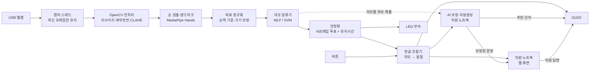

# 수어 지문자 인식 소통 보조 장치 — 구성안 (초안)

| 항목 | 내용 |
|------|------|
| 과목 연계 | 디지털영상처리(OpenCV) + 임베디드 시스템(라즈베리파이) |
| 기간 | 2026-10-30 ~ 2026-12-14 (약 6주) |
| 문서 상태 | 구성안 초안 — 팀 회의에서 확정 전 |
| 관련 문서 | [개발계획서 v0.1](DEVELOPMENT_PLAN.md), [결정 안건 v2](meeting/kshDecision02_261030) |

> 기존 개발계획서는 **단어 수어**(동작 → LSTM) 기준입니다. 이 구성안은 주제를 **지문자**(한글 자모를 손 모양으로 표현)로 잡았을 때의 구성입니다.
> 이미 확정된 사항(각자 노트북 개발, 라즈베리파이 4 사용, 4단계 개발 구조)은 그대로 따릅니다.

---

## 0. 한 장 요약

**무엇을 만드나**
카메라 앞에서 지문자로 한 글자씩 표현하면, 라즈베리파이가 자모를 인식해 **한글 문장으로 조합**하고, **AI가 오인식을 바로잡고 다음 단어를 추천**해 OLED와 직원 화면에 보여주는 소통 보조 장치. 직원의 답변은 다시 사용자 쪽 화면에 표시한다.

```
[사용자] ㄷ → ㅡ → ㅇ → …  (손 모양)
   ↓ 웹캠
[라즈베리파이 4]  OpenCV 전처리 → 손 좌표 추출 → 자모 분류(AI) → 안정화 → 한글 조합
   ↓                         ↓                    ↓ 조합 중 문장 + 자모별 후보 확률
 OLED "등본?" (추천)     LED·부저 (입력 피드백)   [직원 노트북] AI 보정·자동완성
   ↑                                                  ↓ "든본 발급" → "등본 발급"
   └────────── 추천 단어 / 직원 답변 ←───────────── 직원 화면 + 답변 입력
```

**왜 지문자인가 (단어 수어 대비)**

| 비교 | 단어 수어 (기존 계획) | 지문자 (이 구성안) |
|------|----------------------|--------------------|
| 인식 대상 | 동작(시간 흐름) | 대부분 **정지된 손 모양** |
| 모델 | 30프레임 시퀀스 → LSTM | 프레임 1장 → MLP/SVM (가벼움) |
| 데이터 수집 | 영상 수천 개 촬영 | 키 누르며 좌표 저장, 1인 수십 분 |
| 표현 범위 | 학습한 20~50단어만 | **어떤 단어든** 철자로 표현 가능 (이름, 주소 등) |
| 파이 4 부담 | 큼 (R-01 리스크) | 작음 |
| 약점 | — | 한 글자씩이라 느림 → 자동완성·빠른 문장으로 보완 |

**과목별로 보여줄 것**

| 디지털영상처리 (OpenCV) | 임베디드 시스템 (라즈베리파이) |
|-------------------------|--------------------------------|
| 조명 보정(CLAHE), 색공간 변환 | GPIO 출력: 상태 LED, 부저 |
| 피부색 분할·모폴로지·윤곽선 (고전 방식) | GPIO 입력: 버튼 + 인터럽트·디바운스 |
| 손 ROI 추출, 좌표 정규화(기하 변환) | I2C 통신: OLED에 한글 출력 |
| 특징 추출 → 분류, **고전 방식 vs MediaPipe 성능 비교** | 멀티스레드 실시간 처리, FPS 최적화 |
| 결과 시각화 (랜드마크·박스·인식 결과 오버레이) | 부팅 시 자동 실행(systemd), 네트워크 통신 |

**AI가 들어가는 곳**

| 위치 | 하는 일 | 실행 위치 |
|------|---------|-----------|
| 손 랜드마크 추출 | MediaPipe 딥러닝 모델로 손 관절 21점 추출 | 라즈베리파이 |
| 자모 분류기 | 좌표 → 자모 판단 (SVM → MLP/TFLite) | 라즈베리파이 |
| **문장 보정·자동완성** | 오인식된 자모 수정, 다음 단어 추천, 문장 다듬기 | 직원 노트북 (3.5절) |

---

## 1. 목표와 범위

### 1.1 목표
- 지문자 자모를 실시간으로 인식해 한글 음절·문장으로 조합한다.
- 라즈베리파이 4 단독으로 동작하고, 결과를 OLED·LED·부저로 피드백한다.
- AI 문장 보정·자동완성으로 지문자의 약점(느린 입력, 오인식)을 보완한다.
- 직원 노트북과 텍스트를 주고받아 **창구에서 짧은 대화**가 가능함을 시연한다.

### 1.2 인식 대상

| 구분 | 대상 | 개수 | 단계 |
|------|------|------|------|
| 기본 자음 | ㄱ ㄴ ㄷ ㄹ ㅁ ㅂ ㅅ ㅇ ㅈ ㅊ ㅋ ㅌ ㅍ ㅎ | 14 | **MVP** |
| 기본 모음 | ㅏ ㅑ ㅓ ㅕ ㅗ ㅛ ㅜ ㅠ ㅡ ㅣ | 10 | **MVP** |
| 특수 클래스 | 없음/대기 (손을 내리거나 지문자가 아닌 손 모양) | 1 | **MVP** |
| 기타 모음 | ㅐ ㅒ ㅔ ㅖ ㅚ ㅟ ㅢ 등 | ~7 | 확장 |
| 쌍자음 | ㄲ ㄸ ㅃ ㅆ ㅉ | 5 | 확장 |
| 지숫자 | 0~9 (금액·번호 입력용) | 10 | 확장 |

> **MVP 24자 + 대기 1 = 25 클래스**만으로도 조합 규칙(3.4절)을 쓰면 대부분의 한글을 입력할 수 있습니다.
> 예: ㅏ+ㅣ→ㅐ, ㅗ+ㅏ→ㅘ, 쌍자음은 [쌍] 버튼 + 자음.
> 0단계에서 **국립국어원 한국수어사전**으로 각 자모가 "정지 손 모양"인지 "움직임이 있는지" 확인하고, 움직임이 있는 것은 확장 범위로 미룹니다.

### 1.3 제외 범위
- 단어 수어·문장 수어 번역 (시간 남으면 "안녕하세요/감사합니다" 정도만 확장 검토)
- 표정 등 비수지 신호
- 한국어 → 수어 생성
- 영상 저장

---

## 2. 하드웨어 구성

### 2.1 부품 목록

| 품목 | 용도 | 상태 | 대략 가격 |
|------|------|------|-----------|
| 라즈베리파이 4 | 메인 처리 | 보유 | — |
| USB 웹캠 | 손 촬영 | 보유 | — |
| OLED (SSD1306, I2C, 128×64) | 사용자용 화면: 조합 중인 글자, 직원 답변 | 보유 | — |
| LED (빨/노/초 등 3색) | 상태 표시 | 보유 | — |
| 점퍼선 | 배선 | 보유 | — |
| **브레드보드** | 회로 구성 | 추가 요청 | 3천 원 |
| **저항 220~330Ω** | LED 전류 제한 | 추가 요청 | 저항 키트 3천 원 |
| **택트 스위치 ×4** | 띄어쓰기 / 지우기 / 전송(+길게 누르면 쌍자음) / AI 추천 선택 | 추가 요청 | 몇백 원 |
| **능동 부저 (모듈형)** | 글자 확정 "삑" 소리 | 추가 요청 | 1~2천 원 |
| **파이 4 공식 전원 (5V 3A USB-C)** | 전력 부족 방지 | 확인 후 요청 | 1.5만 원 |
| **팬 달린 케이스** | 연속 인식 시 발열로 인한 속도 저하 방지 | 추가 요청 | 1~1.5만 원 |
| microSD 32GB 이상 | OS | 확인 | 1만 원 |
| 웹캠 삼각대 / 스탠드 조명 | 촬영 거리·조명 고정 (정확도에 큰 영향) | 선택 | 각 1~2만 원 |
| 초음파 센서 HC-SR04 + 저항 1kΩ·2kΩ | 사용자가 앞에 서면 자동으로 켜짐 | 선택 (확장) | 2천 원 |
| HDMI 모니터 + micro HDMI 케이블 | 직원 답변을 크게 보여주기 | 선택 | 보유품 |

> 가격은 대략치입니다. OLED는 칩 종류(SSD1306 / SH1106)와 I2C 주소(보통 0x3C)를 먼저 확인하세요.

### 2.2 배선도 (라즈베리파이 4 기준)

| 부품 | 부품 핀 | 파이 물리 핀 (GPIO) | 비고 |
|------|---------|---------------------|------|
| OLED | VCC | 1 (3.3V) | |
| OLED | GND | 6 (GND) | |
| OLED | SDA | 3 (GPIO2) | `raspi-config`에서 I2C 활성화 |
| OLED | SCL | 5 (GPIO3) | |
| LED 초록 (인식 확정) | + | 11 (GPIO17) | 저항 거쳐 GND |
| LED 노랑 (인식 중) | + | 13 (GPIO27) | 저항 거쳐 GND |
| LED 빨강 (손 없음/오류) | + | 15 (GPIO22) | 저항 거쳐 GND |
| 부저 | I/O (+) | 12 (GPIO18) | 모듈형 권장 (트랜지스터 내장) |
| 버튼 1: 띄어쓰기 | 한쪽 | 29 (GPIO5) | 반대쪽 GND, 내부 풀업 사용 |
| 버튼 2: 지우기 | 한쪽 | 31 (GPIO6) | 〃 |
| 버튼 3: 전송 / 길게=쌍자음 | 한쪽 | 33 (GPIO13) | 〃 |
| 버튼 4: AI 추천 선택 (짧게=다음 후보, 길게=적용) | 한쪽 | 35 (GPIO19) | 〃 |
| (선택) HC-SR04 | Trig / Echo | 16 (GPIO23) / 18 (GPIO24) | **Echo는 5V 출력 → 1k·2k 저항 분압 필수** |

> 공통 GND는 9, 14, 39번 핀 등을 사용합니다. 파이 GPIO는 **3.3V**이므로 5V 신호를 직접 넣으면 고장납니다.

### 2.3 입출력 동작 규칙

| 상황 | LED | 부저 | OLED |
|------|-----|------|------|
| 손 없음 | 빨강 | — | 조합 중인 문장 표시 |
| 손 인식, 자모 판단 중 | 노랑 | — | 하단에 후보 자모 "ㅎ?" |
| 자모 확정 | 초록 0.3초 | 짧게 1회 | 문장에 반영 "하" |
| AI 추천 도착 | — | — | 맨 아래 줄에 "▶등본 / 등록" (버튼 4로 선택) |
| 전송 | 초록 깜빡 | 길게 1회 | "전송됨" |
| 직원 답변 도착 | 초록·노랑 교대 | 2회 | 답변 텍스트 (길면 스크롤) |

---

## 3. 소프트웨어 구성

### 3.1 전체 처리 흐름



### 3.2 영상 처리 (디지털영상처리 과목 핵심)

두 가지 방식을 모두 만들어 **비교 실험**하면 영상처리 과목 보고서 내용이 풍부해집니다.

| | 방식 A: 고전 영상처리 (비교용) | 방식 B: 랜드마크 기반 (메인) |
|---|------|------|
| 손 영역 | YCrCb/HSV 피부색 범위 → 이진화 → 모폴로지(열림·닫힘) → 가장 큰 윤곽선 | MediaPipe Hands 21개 관절 좌표 |
| 특징 | Hu 모멘트, 볼록 껍질·결손점(손가락 개수), HOG | 관절 좌표 + 손가락 관절 각도 |
| 분류 | SVM / KNN | MLP (또는 SVM) |
| 장점 | 영상처리 기법을 직접 구현, 과목 취지에 부합 | 배경·피부색 영향 적음, 정확도 높음 |
| 단점 | 조명·배경·옷 색에 약함 | 라이브러리 의존 |

공통 전처리:
- **해상도 축소** (640×480 → 320×240): 파이 4 속도 확보
- **좌우 반전**: 사용자가 거울처럼 보도록
- **CLAHE (LAB의 L 채널)**: 조명이 어둡거나 고르지 않을 때 보정
- **손 ROI 잘라내기**: 랜드마크 박스 + 여백 → 고전 방식 특징 추출·시각화에 사용

좌표 정규화 (방식 B):
1. 손목(0번 점)을 원점으로 이동
2. 손목~중지 뿌리(9번 점) 거리로 나눠 크기 통일 → 카메라 거리에 무관
3. **회전은 정규화하지 않음** — ㅏ/ㅓ, ㅗ/ㅜ처럼 **방향만 다른 자모**를 구분해야 하기 때문
4. 왼손잡이는 x좌표 반전으로 오른손 형태로 통일 (0단계에서 사용 손 규칙 확정)

### 3.3 안정화 (오인식 방지)

프레임마다 결과가 흔들리므로 바로 확정하지 않습니다.
- 최근 N프레임(예: 10프레임) 중 같은 자모가 70% 이상, 확률 평균 0.8 이상이 **0.6초 유지**되면 확정
- 같은 자모를 연속 입력하려면 손 모양을 풀었다가(또는 "대기" 상태를 거쳐) 다시 해야 함 → 한 번 하고 있는 동안 중복 입력 방지
- 임계값(프레임 수, 유지 시간, 확률)은 설정 파일로 빼서 테스트하며 조정

### 3.4 한글 조합기

확정된 자모를 키보드 입력기(두벌식 오토마타)처럼 음절로 조합합니다.
- 예: ㅎ ㅏ ㄴ ㄱ ㅡ ㄹ → "한글", ㅎ ㅏ ㄱ ㄱ ㅛ → "학교"
- 자음 뒤에 모음이 오면 앞 받침이 다음 글자 초성으로 넘어감 (ㄱㅏㄴㅏ → 가나, ✗ 간ㅏ)
- 모음 조합 규칙: ㅏ+ㅣ=ㅐ, ㅓ+ㅣ=ㅔ, ㅑ+ㅣ=ㅒ, ㅕ+ㅣ=ㅖ, ㅗ+ㅣ=ㅚ, ㅜ+ㅣ=ㅟ, ㅡ+ㅣ=ㅢ, ㅗ+ㅏ=ㅘ, ㅜ+ㅓ=ㅝ, ㅘ+ㅣ=ㅙ, ㅝ+ㅣ=ㅞ
- 쌍자음: [버튼 3] 길게 누른 뒤 자음 → ㄲ ㄸ ㅃ ㅆ ㅉ
- 음절 계산: `0xAC00 + (초성×21 + 중성)×28 + 종성` (유니코드 공식)
- 버튼: 띄어쓰기 / 지우기(자모 단위) / 전송 / AI 추천 선택
- **노트북·파이 없이 단위 테스트 가능**한 순수 파이썬 모듈 → 1단계부터 병행 개발하기 좋음

### 3.5 AI 문장 보정·자동완성

지문자는 한 글자씩 입력해서 **느리고**, 자모 하나만 잘못 인식돼도 **단어가 틀립니다** (예: ㅇ을 ㅁ으로 인식 → "등본"이 "듬본"). AI가 이 두 문제를 보완합니다.

**하는 일**

| 기능 | 예시 | 효과 |
|------|------|------|
| 자동완성 | "ㄷㅡㅇ" 입력 → OLED에 "▶등본 / 등록" 추천 → 버튼 4로 선택 | 입력할 자모 수 감소 |
| 단어 보정 | "듬본 발급" → "등본 발급" | 오인식 복구 |
| 문장 다듬기 | "등본 발급 돈 얼마" → 직원 화면에 "등본 발급 수수료가 얼마인가요?" 함께 표시 | 직원이 뜻을 빨리 파악 |

**어떻게 동작하나 — 3단계로 쌓아 올림**

| 레벨 | 방식 | 설명 | 단계 |
|------|------|------|------|
| L1 | 민원 단어 사전 + 자모 편집거리 | 단어 150~200개 사전에서 입력과 가장 가까운 단어 검색. 오프라인·빠름 | **MVP** (1단계) |
| L2 | 인식 확률 반영 보정 | 분류기가 보낸 **자모별 후보 확률**(예: ㅇ 0.55 / ㅁ 0.40)과 혼동행렬을 이용해, "헷갈리기 쉬운 자모끼리는 바꿔도 비용이 적게" 계산 → 더 정확한 보정 | **MVP** (2단계) |
| L3 | 언어 모델(LLM) | 대화 맥락(공공기관 창구)을 주고 문장 보정·다듬기 요청. 클라우드 LLM API 또는 노트북에서 돌리는 소형 로컬 모델 중 선택 | 확장 (3단계) |

> L1·L2만으로도 "AI 보정" 시연이 가능합니다. L2는 우리 분류기의 확률 출력을 그대로 활용하기 때문에, **영상 인식 AI와 언어 보정이 연결되는 부분**으로 발표에서 강조하기 좋습니다.
> L3가 실패하거나 느리면(2초 초과, 인터넷 끊김) 자동으로 L1·L2 결과만 사용합니다.

**실행 위치와 흐름**
- 파이 4는 인식만으로도 바쁘므로, AI 보정은 **직원 노트북**에서 실행합니다.
- 파이가 `composing`(조합 중 문장 + 자모별 후보 확률)을 보냄 → 노트북이 `suggest`(추천 단어, 보정 문장)를 돌려줌 → 파이가 OLED에 표시
- 직원 화면에는 **원래 입력과 보정 문장을 함께** 보여줘서, AI가 잘못 고쳤을 때도 직원이 원문을 확인할 수 있게 합니다.
- 사용자가 추천을 선택하지 않으면 입력한 그대로 전송됩니다 (AI는 제안만 함).

**기타 소통 보조 기능**
- **직원 빠른 답변 버튼**: "신분증을 보여주세요", "잠시만 기다려주세요", "몇 번 창구로 가세요" 등
- **사용자 빠른 문장**: 특정 버튼 조합으로 "도와주세요", "다시 말해주세요"

### 3.6 코드 구조 (기존 폴더에 맞춤)

```
src/
├── data_collection/
│   └── collect.py          # 웹캠 보면서 키 누르면 해당 자모 좌표 저장 (.npy/.csv)
├── model/
│   ├── train.py            # 학습·평가 (혼동행렬, 사람별 교차검증)
│   ├── classic_cv.py       # 방식 A: 피부색 분할·윤곽선 특징 (비교 실험)
│   └── export.py           # TFLite 또는 joblib으로 저장
├── pi/
│   ├── main.py             # 전체 루프
│   ├── camera.py           # 캡처 스레드
│   ├── hand_tracker.py     # 전처리 + MediaPipe + 정규화 (노트북·파이 공용)
│   ├── classifier.py       # 모델 로드·추론
│   ├── stabilizer.py       # 3.3 안정화
│   ├── hangul.py           # 3.4 한글 조합기
│   ├── config.yaml         # 임계값, 핀 번호, 서버 주소
│   └── hw/                 # oled.py, leds.py, buzzer.py, buttons.py
└── staff_app/
    ├── server.py           # Flask-SocketIO
    ├── templates/          # 직원 화면 (원문·보정 문장, 답변 입력, 빠른 답변 버튼)
    └── ai_assist/
        ├── lexicon.csv     # 민원 단어 사전 (단어, 분류, 사용 빈도)
        ├── autocomplete.py # L1: 사전 + 자모 편집거리
        ├── corrector.py    # L2: 후보 확률·혼동행렬 반영 보정
        └── llm_refine.py   # L3: 언어 모델 문장 다듬기 (실패 시 L1·L2로 대체)
```

> `hw/` 모듈은 노트북에서 실행할 때 **가짜(콘솔 출력) 구현**으로 바꿔 끼울 수 있게 만들면, 파이 없이도 1단계 개발이 가능합니다.

**주요 라이브러리**: `opencv-python`, `mediapipe`, `numpy`, `scikit-learn`, (선택) `tensorflow`→TFLite, `gpiozero`, `luma.oled` + `Pillow`(+ 나눔고딕 폰트로 OLED 한글 출력), `flask-socketio`, (L3) LLM API 클라이언트 또는 로컬 모델 실행 도구

### 3.7 통신 메시지 (기존 계획서 8.4 유지·확장)

| 방향 | type | 내용 |
|------|------|------|
| 파이 → 직원 | `composing` | 현재 조합 중인 문장 + 자모별 후보 확률 (AI 보정 입력) |
| 파이 → 직원 | `sent` | 사용자가 [전송]한 문장 |
| 파이 → 직원 | `status` | 손 인식 여부, FPS |
| 직원 → 파이 | `suggest` | AI 추천 단어 목록, 보정 문장 |
| 직원 → 파이 | `reply` | 직원 답변 텍스트 |

```json
{ "type": "composing", "text": "듬본",
  "jamo": [["ㄷ", 0.95], ["ㅡ", 0.91], [["ㅁ", 0.48], ["ㅇ", 0.45]], ["ㅂ", 0.93], ["ㅗ", 0.90], ["ㄴ", 0.94]] }
```

```json
{ "type": "suggest", "candidates": ["등본", "등록"], "corrected": "등본", "level": "L2" }
```

```json
{ "type": "sent", "text": "등본 발급", "timestamp": "2026-12-01T10:00:00" }
```

---

## 4. 데이터·모델

### 4.1 데이터 수집
- `collect.py`로 웹캠을 보며 자모 키를 누르고 있으면 해당 라벨로 좌표가 연속 저장됨 (영상 저장 없음 → 개인정보 부담 적음)
- 목표: **1인 × 25클래스 × 200프레임** ≈ 5,000샘플/인, 4명 = 2만 샘플 (1인 30분 내외)
- 다양성: 손 각도 조금씩 변경, 거리 0.5~1m, 노트북 웹캠 + 시연용 USB 웹캠 모두
- 기준 동작: 국립국어원 한국수어사전 지문자 영상 (4명이 같은 동작으로)
- 가능하면 팀 외 인원 2~3명 추가 수집 → 처음 보는 사람 테스트용

### 4.2 모델
| 항목 | 내용 |
|------|------|
| 입력 | 21점 × (x, y, z) 정규화 좌표 = 63차원 (+ 손가락 각도 특징 선택) |
| 1차 모델 | scikit-learn SVM / RandomForest — 빠르게 기준선 확보 |
| 2차 모델 | MLP (Dense 128-64-25) → TFLite 변환 |
| 증강 | 작은 회전(±10°), 크기, 좌표 노이즈 |
| 검증 | **사람 단위 분리** (3명 학습 → 1명 테스트, 돌아가며) — 처음 보는 사람 성능을 정직하게 측정 |

### 4.3 평가 지표

| 지표 | 목표 (안) | 측정 단계 |
|------|-----------|-----------|
| 자모 정확도 (사람 단위 교차검증) | 90% 이상 | 1단계 |
| 혼동행렬로 헷갈리는 자모 쌍 파악 | 개선 전후 비교 | 2단계 |
| 파이 4 처리 속도 | 15 FPS 이상 | 2단계 |
| 자모 확정 지연 | 1초 이내 | 2단계 |
| 입력 속도 (분당 음절 수) | 시연 문장 기준 측정 | 3단계 |
| 수어 → 직원 화면 전달 지연 | 0.5초 이내 | 3단계 |
| 고전 방식(A) vs 랜드마크 방식(B) 정확도·속도 비교 | 보고서용 | 2단계 |
| AI 보정 전후 문자 오류율 (테스트 문장 30개) | 보정 후 오류율 절반 이하 | 2~3단계 |
| 자동완성으로 줄어든 입력 자모 수 | 30% 이상 절감 | 3단계 |
| AI 추천 응답 시간 | L1·L2 0.3초 / L3 2초 이내 | 3단계 |
| 보정이 오히려 틀리게 만든 비율 | 5% 이하 | 3단계 |

---

## 5. 단계별 개발 계획 (기존 4단계 구조에 매핑)

| 단계 | 기간 | 목표 | 완료 기준 |
|------|------|------|-----------|
| 0. 준비 | 10/30 ~ 11/8 | 범위 확정, 환경·부품 준비 | 25클래스 확정, 수어사전 기준 영상 공유, 파이 4 + OLED/LED/버튼 동작 확인, 파이 MediaPipe FPS 측정, 민원 단어 사전 초안 |
| 1. 인식·해석 | 11/9 ~ 11/20 | **노트북**에서 자모 인식 + 한글 조합 | 노트북 화면에 "한글" 입력 성공, 사람 단위 정확도 측정, AI 자동완성(L1) 텍스트 테스트 |
| 2. 수정·개선 + 파이 이식 | 11/21 ~ 11/27 | 정확도·속도 개선, 파이 4에서 단독 동작 | 파이에서 OLED·LED·부저·버튼으로 입력 가능, 고전 방식 비교 완료, 확률 반영 보정(L2) 완성 |
| 3. 직원에게 전달 | 11/28 ~ 12/4 | [전송] 문장 → 직원 노트북 화면 | 직원 화면에 원문·보정 문장 실시간 표시, OLED에 AI 추천 표시, (선택) L3 연동 |
| 4. 쌍방향 소통 | 12/5 ~ 12/11 | 직원 답변 → OLED(+모니터) | 시연 시나리오 전체 동작, AI 보정 효과 측정 |
| 마무리 | 12/12 ~ 12/14 | 버퍼, 리허설, 보고서 | 12/14 시연 |

**병행 개발** (결정 안건 v2의 2번 추천안과 동일 원칙)

| 담당 | 0단계 | 1단계 | 2단계 | 3·4단계 |
|------|-------|-------|-------|---------|
| A. 데이터·영상처리 | 수어사전 정리, `collect.py` | 데이터 수집, 전처리·정규화 | 고전 방식(A) 비교 실험 | 시연용 웹캠 추가 수집 |
| B. 모델·AI 보정 | 환경 세팅, 민원 단어 사전 초안 | 분류기 학습·평가, 자동완성(L1) | 혼동 자모 개선, TFLite, 혼동행렬 반영 보정(L2) | (선택) LLM 보정(L3), AI 보정 효과 측정 |
| C. 임베디드 | 파이 세팅, 배선, FPS 측정 | `hw/` 모듈 (OLED 한글, LED, 버튼, 부저) | 파이 이식·최적화, 자동 실행 | OLED 추천 표시·버튼 4 선택, 장치 마감 |
| D. 조합기·통신 | JSON 형식 확정 | `hangul.py` + 단위 테스트, 직원 화면 (가짜 데이터) | 안정화 로직 연결 | 통신·AI 보정 연결, 원문/보정 비교 화면, 빠른 답변 |

> AI 보정은 B가 주 담당입니다. 1단계 이후 분류기 작업이 줄어드는 시점에 맞춰 배치했고, 사전 작성은 0단계에 전원이 함께 합니다.

---

## 6. 시연 시나리오 (안)

| 순서 | 사용자 (지문자) | 장치 반응 | 직원 |
|------|----------------|-----------|------|
| 1 | 앞에 섬 (선택: 초음파로 자동 시작) | OLED "지문자로 말씀해주세요" | |
| 2 | ㄷ ㅡ ㅇ | 글자마다 삑 + 초록 LED, OLED "등" + 추천 "▶등본 / 등록" | 화면에 조합 과정 실시간 표시 |
| 3 | 버튼 4 길게 (추천 적용) → [띄어쓰기] ㅂ ㅏ ㄹ | OLED "등본 발" + 추천 "▶발급" → 적용 | |
| 4 | [전송] | "전송됨" | "등본 발급" 수신 (자모 12개 중 6개만 입력) |
| 4-1 | (오인식 시연) ㅇ이 ㅁ으로 인식돼 "듬본" | OLED 추천 "▶등본" | 원문 "듬본" / 보정 "등본" 함께 표시 |
| 4 | | OLED에 답변 표시 | [빠른 답변] "신분증을 보여주세요" |
| 5 | ㄴ ㅔ (ㄴ ㅓ ㅣ) [전송] | | "네" 수신 |
| 6 | | | "500원입니다" 입력 |

---

## 7. 리스크와 대응

| 리스크 | 대응 |
|--------|------|
| 비슷한 손 모양 자모끼리 혼동 | 혼동행렬로 파악 → 각도 특징 추가, 해당 자모 데이터 추가, 안정화 임계값 상향 |
| 파이 4에서 MediaPipe 느림 | 320×240 입력, `model_complexity=0`, 캡처/추론 스레드 분리, 2프레임 중 1프레임만 처리. 그래도 부족하면 추론을 노트북으로 이전 (대안 구조) |
| 처음 보는 사람 인식률 저하 | 사람 단위 검증으로 미리 확인, 팀 외 인원 데이터 추가 |
| 조명·배경 변화 | CLAHE, 스탠드 조명·단색 배경으로 설치 조건 고정 |
| OLED에 한글이 안 나옴 | `Pillow` + 나눔고딕 TTF로 이미지 렌더링 후 출력 (0단계에 먼저 확인) |
| 3.3V/5V 배선 실수로 파이 손상 | 배선표대로만 연결, HC-SR04는 분압 확인 후 연결 |
| 지문자 입력이 느려 대화가 답답함 | 3.5절 자동완성·빠른 답변으로 보완, 시연 문장은 짧게 |
| AI 보정이 맞는 입력을 틀리게 고침 | 자동 적용하지 않고 **추천만** 함, 직원 화면에 원문 함께 표시, 사전에 없는 단어(이름 등)는 보정 안 함 |
| LLM(L3) 응답 지연·인터넷 끊김 | 2초 넘으면 L1·L2 결과만 사용, 시연은 L1·L2만으로도 가능하도록 구성 |
| 클라우드 LLM으로 개인정보(이름·주소) 전송 | 로컬 모델 우선 검토, 클라우드 사용 시 사전에 없는 고유명사는 가린 뒤 전송, 시연 화면에 안내 문구 |

---

## 8. 이번 회의에서 정할 것

| # | 안건 | 추천안 |
|---|------|--------|
| 1 | 주제를 단어 수어 → **지문자**로 바꿀지 | 지문자로 변경 (6주·파이 4 조건에서 현실적, 영상처리·임베디드 과목 요소를 모두 보여주기 좋음) |
| 2 | MVP 인식 범위 | 기본 자모 24 + 대기 1, 나머지는 조합 규칙·버튼으로 처리 |
| 3 | 사용자 쪽 출력 | OLED 필수 + (선택) HDMI 모니터에 큰 글씨 |
| 4 | 띄어쓰기·지우기·전송·추천 선택 방식 | 버튼 4개 (제스처 방식은 오인식 위험) |
| 5 | 추가 요청 부품 | 브레드보드, 저항, 택트 스위치 4, 능동 부저, 파이 4 전원·팬 케이스 (선택: 조명, 삼각대, HC-SR04) |
| 6 | 고전 영상처리 방식(A) 비교 실험 포함 여부 | 포함 (영상처리 과목 평가 대비) |
| 7 | AI 보정 범위 | L1·L2는 필수, L3(LLM)는 3단계에 여유 있으면 추가 |
| 8 | L3를 쓴다면 클라우드 API vs 로컬 모델 | 0단계에 둘 다 짧게 테스트 후 결정 (비용·속도·개인정보 비교) |
| 9 | 민원 단어 사전 | 0단계에 전원이 150~200단어 작성 (분류별 분담) |
| 10 | 역할 배정 | 5장 표 기준 (A·B 짝, C·D 짝), AI 보정은 B 주 담당 |
